# ISAC 6G Low-Earth Orbit Economic Breakthrough! Collaborative ISAC Technology Achieves Precision Perception and Parameter Estimation for Drones [with MATLAB Code]

New breakthrough in low-altitude economy with 6G! Collaborative ISAC technology achieves precise perception and parameter estimation for unmanned aerial vehicles.
Title: Collaborative Perception Communication Integrated for Low-Elevation Economy
This paper proposes an integrated cooperative perception and communication (ISAC) scheme for low-altitude perception scenarios, aimed at estimating drone parameters and enhancing perception performance through collaboration. The scheme is divided into two stages:
Introduction In the new generation 5G-A and 6G mobile communication systems, low-altitude applications in transportation, tourism, agriculture, emergency services, and other fields are thriving, driving the rise of the low-altitude economy. The interaction between drones and base stations is key to the development of this economy. Drones need to communicate with base stations to complete data transmission, while base stations also need to perceive and detect drones to prevent illegal intrusions and collision risks. Perception and communication integration (ISAC) has become a highly promising solution, offering superior perception capabilities and high-speed data transmission compared to traditional radar deployments.
In low-altitude perception scenarios, the ISAC architecture is categorized into three types based on the spatial deployment of the transmitter and receiver: single base station, dual base stations, and multibase stations. Dual and multibase systems require high precision in the positioning of base stations and synchronization, while single base station architectures involve a base station that simultaneously emits perception symbols and receives echo signals from drones. This simplifies base station deployment and enhances system's asynchronous tolerance. However, the traditional single base station architecture still has limitations: the perception performance of distant drones deteriorates due to path loss, obstacles significantly reduce detection probability, and it can only infer radial velocity from echo signals, failing to fully capture the comprehensive state of the drone, such as its actual speed.
To address the limitations of traditional single-baseline architectures, a collaborative ISAC framework has emerged. In this framework, each base station first estimates target parameters from the echo signal and then fuses these estimates in the cloud. This not only enhances the probability of detecting distant targets and network coverage but also leverages the multi-directional perception of distributed base stations to obtain richer target information, reducing estimation errors and restoring the real speed of unmanned aerial vehicles (UAVs) in three dimensions. Although existing research has preliminarily validated the potential of collaborative ISAC, it mostly focuses on special scenarios such as single antenna and single target, lacking generality for complex real-world scenarios: some algorithms for parameter estimation in a single-baseline scenario are not yet adequately addressed when dealing with multiple targets; data association issues in multi-base station collaboration are also limited to single-antenna architectures. To address these issues, this paper proposes a comprehensive solution for more versatile multi-antenna and multi-target sensing scenarios within the collaborative ISAC framework.
Method Introduction The collaborative ISAC scheme proposed in this paper is a two-stage architecture, with preliminary preprocessing steps designed. It has been extended to bipolar systems, focusing on the core methods of single-base station parameter estimation and multi-base station data fusion for positioning and speed measurement. The specific design is as follows:
1  
Preliminary preprocessing steps: To enhance the practicality of the proposal, a preliminary positioning of the drone is determined through beam scanning, followed by the completion of drone detection using binary hypothesis testing. Utilizing the Minimum Description Length Criterion, we estimate the number of drones within the beamwidth by singular value decomposition of the received signal covariance matrix. Finally, complete the beam alignment, group the antenna arrays and align them with the direction of the drone, providing prior information for subsequent parameter estimation.
2  
Single-base parameter estimation (Phase 1): Firstly, construct a three-order tensor decomposition model to model the received signal as a tensor in space, time, and frequency dimensions. Combine the drone's arrival angle, Doppler shift, and delay characteristics to define the factor matrix. Secondly, utilize the van der Waerden structure of the factor matrix to perform spatial smoothing on the tensor, then recover each factor matrix through truncation singular value decomposition and eigenvalue decomposition. Finally, estimate parameters such as the drone's delay, distance, Doppler shift, and radial velocity from the recovered factor matrices. To address the high computational complexity of arrival angle estimation, a dimensionality reduction algorithm based on generalized Rayleigh quotient is designed. This converts two-dimensional search into two one-dimensional searches, significantly reducing complexity.
3  
Multi-base station data fusion positioning and speed measurement (Phase II): First, a method for removing false detections from the minimum spanning tree is proposed. Starting with the arrival angle and distance estimation results of each base station, a rough position of the drone is obtained by constructing an undirected weighted graph and removing isolated vertices corresponding to false detections. Subsequently, the multi-base station estimates for the same drone are clustered using the minimum spanning tree, achieving precise data matching. This approach has lower complexity than exhaustive listing methods and can eliminate interference from false detections; secondly, a Pareto optimality method is employed to estimate positions. A distance loss function and a direction loss function are defined, with the mean-based fusion result serving as a rough position. A grid is constructed around this position and outliers are eliminated to obtain a set of Pareto optimal positions based on system configuration (subcarriers, number of antennas). Finally, a residual weighting scheme is introduced to estimate true speed. The radial velocity is projected into three-dimensional space to form an equation, followed by steps involving base station grouping, calculating residuals for each group, and then weighted aggregation to obtain a more robust estimate of the drone's true speed, addressing the issue of sensitivity to estimation errors in traditional weighted least squares methods.
4  
Bi-Polarization System Expansion: Expanding the three-order tensor model under unipolarization to a four-order tensor, introducing polarization factors to construct bi-polarization perception channel matrices. Recovering the factor matrix that incorporates polarization information through tensor decomposition, and then achieving decoupling of polarization factors from other parameters through singular value decomposition, ultimately completing parameter estimation. This enhances estimation accuracy even when antenna array sizes are limited.
In addition, this paper also analyzes the uniqueness of tensor decomposition and verifies that the proposed method can ensure the correct recovery of factor matrices and the automatic pairing of parameters. The complexity analysis is completed, and the computational load of each step is quantified, proving the engineering feasibility of the method.
Conclusion This paper proposes a comprehensive collaborative ISAC (In-Situ Sensor Calibration) solution for low altitude perception scenarios, covering the entire process from single base station parameter estimation, multi-base station data association, to multi-base station collaborative perception. The solution begins with preliminary preprocessing through beam scanning, drone detection, and beam alignment. It then employs a tensor decomposition model to achieve precise estimation of multiple parameters for single base station drones, and designs a dimensionality reduction algorithm to reduce computational complexity. Subsequently, it introduces a pseudo-minimum spanning tree association method to precisely match the multi-base station estimation results with drones. Following this, it enhances the estimation performance of drone position and true velocity using both Pareto optimal methods and residual weighting schemes. Additionally, the solution is extended to dual polarization systems, further improving estimation accuracy.
The simulation results fully verify the superiority of the proposed scheme: The performance of single-baseline parameter estimation is superior to traditional methods based on MUSIC and FFT, with higher computational efficiency; The complexity of multi-base station data association is significantly lower than exhaustive permutation when there are many drones; Pareto optimal position estimation and residual weighted speed estimation significantly improve the accuracy of positioning and speed measurement compared to traditional mean fusion and weighted least squares method; The extension design of dual-polarization systems achieves performance enhancement under limited antenna resource conditions. Furthermore, when the scheme degrades to a single-antenna, single-target scenario, it still exhibits superior perception performance compared to existing advanced solutions, and reduces cloud transmission overhead and base station synchronization requirements, demonstrating the universality and engineering application value of the scheme.

## Images

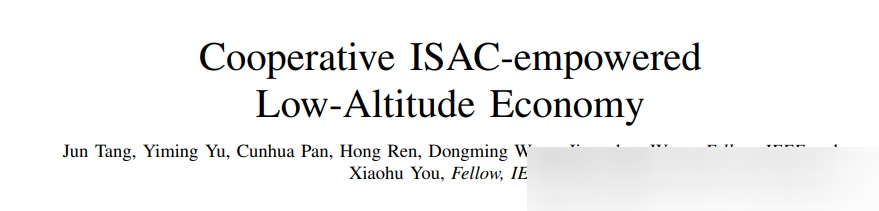
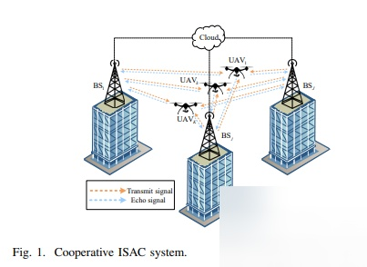
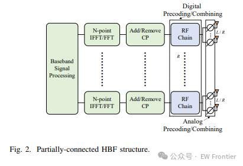
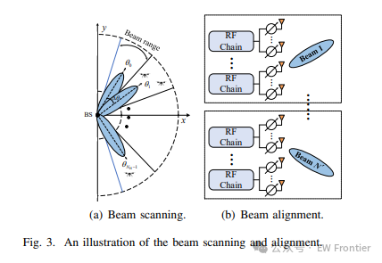
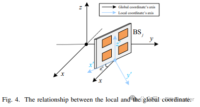
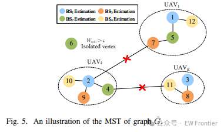
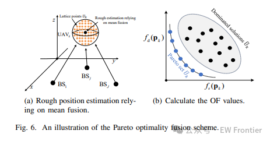
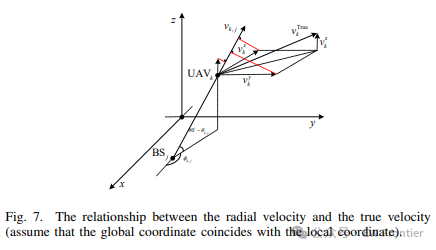
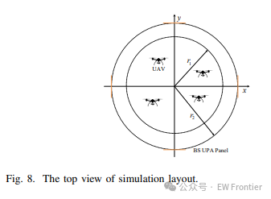
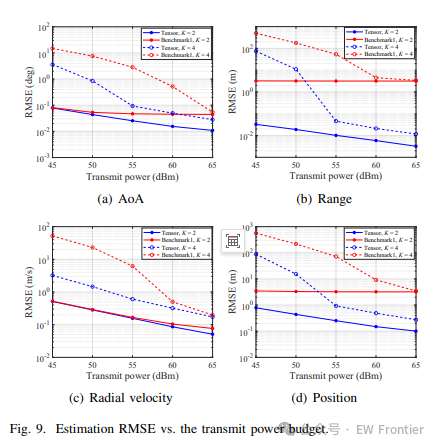
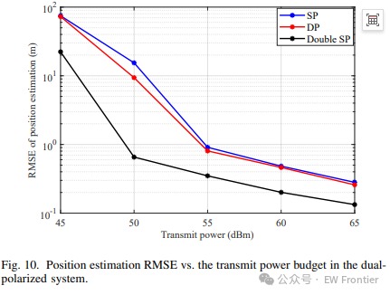

<!-- PAYMENT_BLOCK -->

## Get this dataset

- Payment link (Stripe): [Buy now](https://buy.stripe.com/3cs8yP7sY87d0vu9AB)
- Payment QR code: 

<!-- /PAYMENT_BLOCK -->
